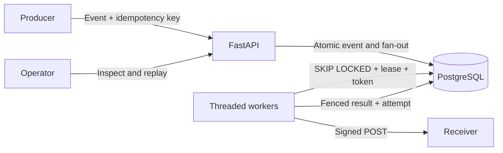

# Relay

Relay delivers signed webhooks using a PostgreSQL-backed queue with retries, leases and a dead-letter queue.

Producers should not wait for subscribers to recover. Relay stores an event and its matching deliveries together, then independent workers send them. A worker crash leaves recoverable leases. Receivers must deduplicate events because delivery is at least once.

## Measured results

Generated from [the benchmark JSON](results/benchmark-20261011-161927.json). Regenerate the detailed report with `python -m bench.report results/benchmark-20261011-161927.json`. All runs below used PostgreSQL 18.4.

Source: `benchmark-20261011-161927.json`

Commit: `1b2d7f417e7b3d75904fbd8f74625e49cbce36ff`; dirty: False
Command: `D:\friends_projects\webhook-relay\.venv\Scripts\python.exe -m bench.run`
Machine: {'os': 'Windows-10-10.0.26200-SP0', 'cpu_model': 'Intel64 Family 6 Model 186 Stepping 2, GenuineIntel', 'cores': 16, 'ram_gb': 15.65}
Tests at this commit: {'passed': 233, 'failed': 0, 'skipped': 0}

| Workers | Median deliveries/s | Median p50 ms | Median p95 ms | Median p99 ms |
| --- | ---: | ---: | ---: | ---: |
| 1 | 42.58 | 135094.65 | 252357.67 | 278318.23 |
| 2 | 87.11 | 77200.35 | 148486.98 | 168053.93 |
| 4 | 170.26 | 60198.38 | 102023.01 | 113975.83 |

| Run | Expected | Unique acknowledged | Dead | Lost | Duplicates |
| --- | ---: | ---: | ---: | ---: | ---: |
| 1 workers / 1 | 10000 | 10000 | 0 | 0 | 722 |
| 1 workers / 2 | 10000 | 10000 | 0 | 0 | 722 |
| 1 workers / 3 | 10000 | 10000 | 0 | 0 | 722 |
| 2 workers / 1 | 10000 | 10000 | 0 | 0 | 722 |
| 2 workers / 2 | 10000 | 10000 | 0 | 0 | 722 |
| 2 workers / 3 | 10000 | 10000 | 0 | 0 | 722 |
| 4 workers / 1 | 10000 | 10000 | 0 | 0 | 722 |
| 4 workers / 2 | 10000 | 10000 | 0 | 0 | 722 |
| 4 workers / 3 | 10000 | 10000 | 0 | 0 | 722 |
| hard kill | 10000 | 10000 | 0 | 0 | 722 |

Windows hard-kill uses TerminateProcess; POSIX uses SIGKILL.
Both abruptly stop a worker without running its cleanup handlers.
Latency uses PostgreSQL event creation and success timestamps; wall time begins after seeding and includes worker startup.

## Architecture



1. Create a subscription and store its one-time secret at the receiver.
2. Submit an event with an optional global idempotency key.
3. One transaction inserts the event and deliveries for matching active subscriptions.
4. Workers claim due rows using short transactions and fresh fencing tokens.
5. Free executor threads send signed payloads without holding database locks.
6. A fenced transaction records the attempt and success, retry time or dead state.
7. Expired claims can be reclaimed; operators can inspect attempts and replay terminal deliveries.

## Quickstart

Requires Python, Docker Desktop with a running Linux engine, and Make. Run from the repository root:

```sh
make setup
make up
make lint
make test
make demo
make api
```

Windows without Make: create `.venv` with `python -m venv .venv`, install with `.venv\Scripts\python -m pip install -r requirements-lock.txt -e ".[dev]"`, then use that interpreter for the commands below. A native PostgreSQL can replace Docker: set `RELAY_DATABASE_URL` to a role with LOGIN and CREATEDB privileges (tests create isolated databases), then run `python -m relay.db`. The default DSN is `postgresql://relay@127.0.0.1:55432/relay`. Compose uses trust authentication on a loopback port for local development only.

```sh
python -m ruff check .
python -m ruff format --check .
python -m pytest
python scripts/demo.py
python -m uvicorn relay.api:app --host 127.0.0.1 --port 8101
python -m relay.worker --concurrency 8 --batch 16 --lease-s 30 --poll-ms 50
```

The API exposes interactive documentation at `/docs`. Set `RELAY_ADMIN_TOKEN` to require `Authorization: Bearer <token>` for management endpoints. Configuration is listed in [.env.example](.env.example); environment files are not loaded automatically.

## API examples

```sh
curl -X POST http://127.0.0.1:8101/subscriptions -H 'Content-Type: application/json' -d '{"url":"https://example.com/webhook","event_types":["order.created"]}'
curl -X POST http://127.0.0.1:8101/events -H 'Content-Type: application/json' -H 'Idempotency-Key: order-123' -d '{"type":"order.created","payload":{"order_id":"123"}}'
curl 'http://127.0.0.1:8101/deliveries?status=dead&limit=20&offset=0'
curl http://127.0.0.1:8101/deliveries/1/attempts
curl -X POST http://127.0.0.1:8101/deliveries/1/replay
curl http://127.0.0.1:8101/stats
```

Use `curl.exe` on Windows PowerShell if `curl` is an alias. Get a subscription with `GET /subscriptions/{id}`, disable it with `PATCH` and `{"active":false}`, and inspect an event with `GET /events/{id}`. Secrets are never returned by subsequent reads. Replay accepts succeeded or dead deliveries, resets the attempt budget and preserves history.

## Key choices

- Atomic fan-out eliminates the event/queue dual-write gap.
- SKIP LOCKED permits independent workers without holding locks during HTTP.
- Leases recover crashes; fencing prevents stale results from changing newer state.
- Full jitter spreads transient retries; permanent responses terminate promptly.
- A synchronous thread pool keeps concurrency bounded and the control flow inspectable.

See [DECISIONS.md](DECISIONS.md) for alternatives, trade-offs and retry-window calculations.

| Crash point | Recovery | Safety boundary |
|---|---|---|
| Before claim commit | Transaction rolls back | Row stays eligible |
| After claim, before HTTP | Lease expires | Another worker can send |
| During HTTP | Lease expires and delivery is retried | Receiver may see a duplicate |
| After acknowledgement, before result commit | Lease expires and delivery is retried | Receiver deduplication is required |
| During result transaction | Attempt and state commit together or roll back | No partial result |
| Old worker finishes after a new claim | Record a stale attempt only | Fencing rejects the old token |

## Testing and benchmarks

The final clean-checkout verification passed **258 tests**, lint, formatting and the signed delivery demo, with **97% statement coverage** on Windows and native PostgreSQL 18.4. See the [verification record](results/verification-20261011-182243.json) for the exact source commit and commands. Docker Compose configuration validation passed; the PostgreSQL 16 Docker runtime was not exercised because the local Docker Linux engine was unavailable.

`make test` runs unit, real PostgreSQL integration, HTTP end-to-end and process-chaos tests. Database unavailability fails the suite rather than silently skipping integration tests. Test databases are uniquely named and dropped on exit; normal application data is not truncated by the harness.

| Cases | What they prove |
|---|---|
| Retry bounds, seeded jitter, huge attempt | Finite bounded retry scheduling |
| Signature tampering, wrong secret, timestamp and malformed headers | Exact-byte integrity and replay-window checks |
| Fan-out, idempotency and concurrent claims | Atomic writes and disjoint claimers |
| Expiry and stale completion including stale 410 | Recovery without stale state or subscription mutation |
| Permanent errors, attempt budget and replay | Terminal behavior and preserved audit history |
| Failing receiver, hard kill and graceful stop | Real process recovery and bounded shutdown |

`make bench` measures the specified worker matrix and a separate hard-kill run. For a smoke check: `python -m bench.run --events 30 --subscriptions 2 --workers 1 2 --repeats 1`. Full and smoke workloads must not be compared as equivalent.

Definitions: `lost` is expected event/subscription pairs absent from both acknowledged receiver pairs and dead pairs. `duplicates` is acknowledged receipts minus unique acknowledged pairs. Latency is PostgreSQL success time minus event creation time. Throughput is succeeded deliveries divided by drain wall time. Reported matrix values are medians across repetitions. Windows hard-kill uses TerminateProcess; POSIX uses SIGKILL. The graceful Windows stop-file path exercises draining without claiming Unix signal coverage.

## Limitations

No per-subscription ordering, multi-region failover, tenant isolation, secret rotation, delivery retention policy, circuit breaker or rate limiting. PostgreSQL is the durability and availability boundary. A finite retry budget ends in dead state rather than guaranteed eventual receiver success. Authentication is a static operator token; outbound URLs need SSRF defenses before public exposure. The mock receiver stores receipts and dedupe state in memory and is not a production receiver.

Next improvements are Retry-After support, per-subscription circuit breaking and a durable receiver deduplication example. Performance results describe the recorded local machine and workload, not a production capacity guarantee.

## License

MIT License. Copyright (c) 2026 Sayna Kumari. See [LICENSE](LICENSE).
